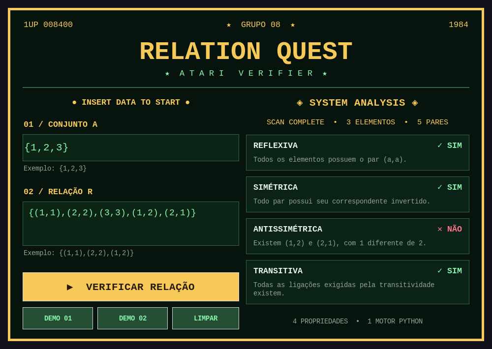

# Relation Quest — Atari Verifier

Verificador visual de relações binárias desenvolvido em Python com Tkinter, com aparência retrô de fliperama. Projeto de Matemática Discreta do Grupo 08.



## Funcionalidades

- Verifica se uma relação é reflexiva, simétrica, antissimétrica e transitiva.
- Apresenta um contraexemplo quando uma propriedade não é satisfeita.
- Valida conjuntos de números inteiros e os pares da relação.
- Inclui dois exemplos de demonstração.

## Como executar

É necessário ter Python 3 com suporte a Tkinter. Não há dependências externas para instalar com pip.

```bash
python jogo.py
```

No Windows, também é possível abrir `INICIAR_WINDOWS.bat` com dois cliques. Em instalações do Python sem Tkinter, instale o suporte a Tk pelo gerenciador do seu sistema.

## Como usar

1. Em **CONJUNTO A**, digite `{1,2,3}`.
2. Em **RELAÇÃO R**, digite `{(1,1),(2,2),(3,3),(1,2),(2,1)}`.
3. Clique em **VERIFICAR RELAÇÃO** para consultar as quatro propriedades.

Use **DEMO 01** e **DEMO 02** para carregar exemplos. Para uma relação vazia, digite `{}`.

As propriedades são verificadas para a relação R sobre o conjunto A. Antissimetria é diferente de assimetria; uma relação pode satisfazer várias propriedades simultaneamente.

## Arquivos

- `jogo.py`: interface gráfica.
- `motor.py`: leitura, validação e verificação matemática.
- `INICIAR_WINDOWS.bat`: inicializador para Windows.
- `LEIA-ME.txt`: instruções e explicações do projeto.
- `PREVIA_ATARI.png`: prévia da interface.
